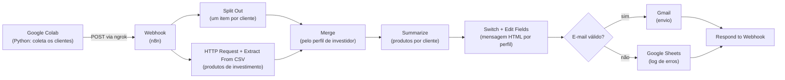
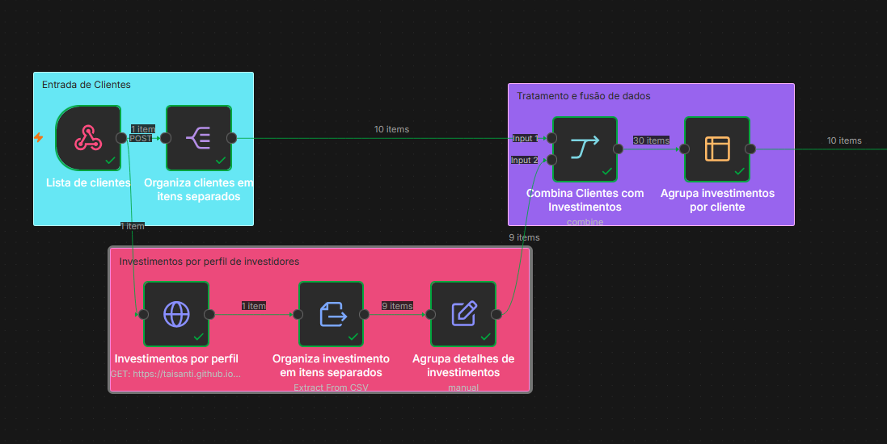
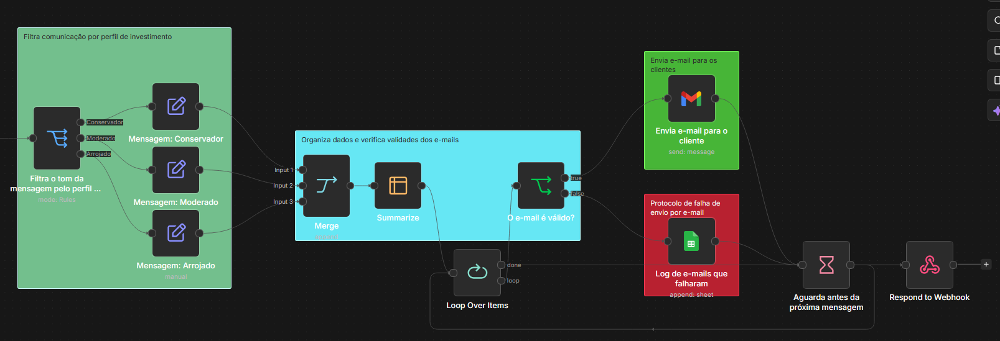
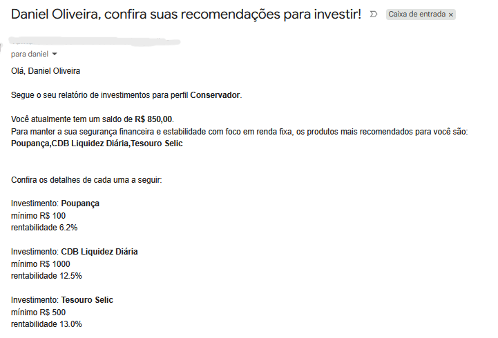
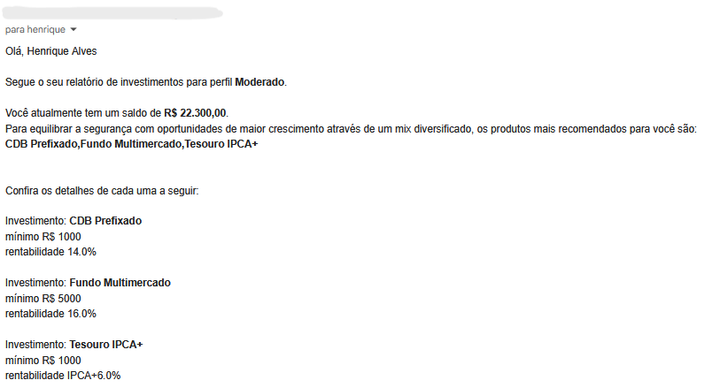
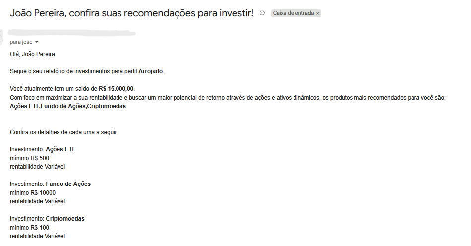
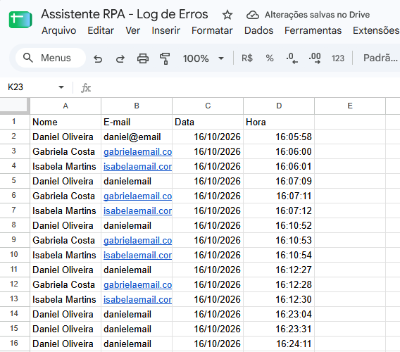

# 📈 Assistente de Investimentos com RPA e n8n

Automação que lê uma lista de clientes de uma página web, cruza o **perfil de investidor** de cada um com uma tabela de produtos e envia **e-mails personalizados** por perfil. E-mails com erro de digitação não são enviados: vão para um **log de erros** no Google Sheets.

Projeto de conclusão do **Bootcamp de n8n da DIO** ("Criando um assistente de investimentos com RPA e IA generativa"). O repositório documenta todo o processo, com os nós organizados em regiões por *sticky notes*.

> **Os dados são fictícios.** Os clientes, saldos e e-mails da página de exemplo não pertencem a pessoas reais.

🔗 [Página de clientes (GitHub Pages)](https://taisanti.github.io/dio-lab-assistente-investimentos-rpa-n8n/)

---

## 🧭 Visão geral



## 🛠️ Ferramentas

| Etapa | Ferramenta | Função |
|---|---|---|
| Hospedagem dos dados | GitHub Pages | Serve a página de clientes (`index.html`) e o CSV de investimentos (`data.csv`) |
| Extração (RPA) | Python + BeautifulSoup, no Google Colab | Lê a tabela de clientes da página e envia ao n8n |
| Conexão | ngrok | Cria um túnel público para o n8n local, para que o Colab consiga alcançá-lo |
| Orquestração | n8n (rodando localmente no Docker) | Cruza os dados, monta as mensagens e controla o envio |
| Envio | Gmail | Dispara os e-mails personalizados |
| Registro de falhas | Google Sheets | Guarda o log de e-mails inválidos |

## 🧩 Arquitetura da automação

O fluxo está dividido em regiões, cada uma com uma responsabilidade.

### 1. Entrada de clientes, produtos e fusão de dados



**Entrada de clientes**

- **Webhook:** recebe, via `POST`, a lista de clientes enviada pelo script Python do Google Colab. O n8n local é alcançado por meio do túnel do ngrok.
- **Split Out:** separa os clientes em itens individuais, a partir do campo `clientes` do corpo (`body`) da requisição.

**Investimentos por perfil de investidor**

- **HTTP Request:** busca o CSV de investimentos hospedado no GitHub.
- **Extract From File:** transforma o CSV em itens separados, um por produto.
- **Edit Fields:** monta, para cada produto, o texto com nome, valor mínimo e rentabilidade, que será usado no e-mail (campo "Detalhes de investimentos").

**Tratamento e fusão de dados**

- **Merge:** une a lista de clientes com os investimentos pelo campo em comum, o **perfil de investidor**.
- **Summarize:** como cada perfil tem mais de um produto, agrupa os produtos por cliente. Assim, cada cliente recebe **um único e-mail** com todos os produtos, e não três.

### 2. Mensagem por perfil, validação e envio



**Filtra comunicação por perfil**

- **Switch:** separa o tom da mensagem conforme o perfil: Conservador, Moderado ou Arrojado.
- **Edit Fields (3x):** formatam a mensagem personalizada em HTML, usando os dados dos nós anteriores.

**Organiza dados e verifica a validade dos e-mails**

- **Merge (modo Append):** reúne as três saídas dos Edit Fields em uma só entrada, garantindo que todos os e-mails passem pelo nó seguinte.
- **Summarize:** une o campo `mensagem` vindo de todos os Edit Fields.
- **If:** valida, com uma expressão regular, se o e-mail tem formato válido.

**Envio e proteção contra falhas**

- ✅ **E-mail válido:** é enviado pelo Gmail.
- ❌ **E-mail inválido:** é registrado, com data e hora, em uma planilha do Google Sheets (log de erros).
- **Loop Over Items + Wait:** inserem um intervalo de 5 segundos entre um envio e outro.
- **Respond to Webhook:** devolve o código de sucesso (`200`) ao script Python no Colab.

> A validação confere apenas o **formato** do e-mail. Um endereço bem escrito, mas inexistente, passa pelo If e só falha na entrega, fora do fluxo.

## ✉️ E-mails enviados

Cada perfil recebe uma mensagem com um tom próprio, montada com os dados do cliente (nome, saldo e produtos recomendados).

| Conservador | Moderado | Arrojado |
|---|---|---|
| Foco em segurança e renda fixa | Equilíbrio entre segurança e crescimento | Foco em rentabilidade e maior potencial de retorno |
|  |  |  |

## 🧾 Log de erros

E-mails com erro de digitação não são enviados: o nome, o e-mail digitado, a data e a hora ficam registrados em uma planilha do Google Sheets.



## ▶️ Como reproduzir

1. Faça um **fork** deste repositório e ative o **GitHub Pages** (Settings → Pages → branch `main`, pasta `/docs`).
2. No notebook `src/extrair_clientes.ipynb`, ajuste o `URL_PAGINA` para a URL do **seu** GitHub Pages.
3. Suba o n8n localmente (Docker) e abra um túnel com `ngrok http 5678`.
4. No n8n, importe o arquivo `n8n/workflow.json`.
5. Configure as suas credenciais do **Gmail** e do **Google Sheets**, e crie uma planilha com as colunas `Nome`, `E-mail`, `Data` e `Hora`.
6. No nó Webhook, clique em **Listen for test event**. No notebook, coloque a URL do ngrok (com o caminho do Webhook) em `N8N_WEBHOOK` e execute.

> Ao testar, use **e-mails seus** nos dados de exemplo. Alguns endereços fictícios usam domínios que existem de verdade, e o envio chegaria a desconhecidos.

## 📁 Estrutura do repositório

```
├── README.md
├── docs/
│   ├── index.html                 # página de clientes
│   └── data.csv                   # opções de investimento por perfil
├── src/
│   └── extrair_clientes.ipynb     # script de RPA (Python)
├── n8n/
│   └── workflow.json              # workflow exportado do n8n
└── imagens/                       # imagens usadas neste README
```

## 💭 Conclusão

Comecei o bootcamp sem nenhum conhecimento prévio de n8n. Com o apoio das aulas e de IA, consegui concluir o desafio e montar a minha primeira automação com APIs configuradas. Minha única crítica é que a aula do desafio de conclusão é pouco esclarecedora e confusa.

---

Feito por Tai ([@taisanti](https://github.com/taisanti)) · Projeto base: [DIO](https://github.com/digitalinnovationone/dio-lab-assistente-investimentos-rpa-n8n)
